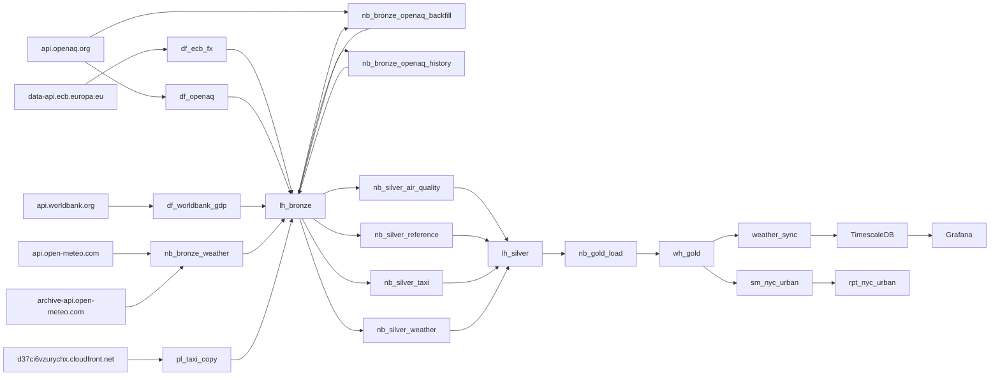
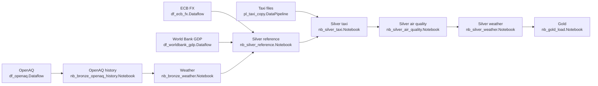

# Lineage

## Items

## Bronze and Silver

| Item | Reads | Writes |
|---|---|---|
| df_ecb_fx | `data-api.ecb.europa.eu` | `lh_bronze.ecb_usd_eur` |
| df_openaq | `api.openaq.org` | `lh_bronze.openaq_hours_landing`, `lh_bronze.openaq_sensors` |
| df_worldbank_gdp | `api.worldbank.org` | `lh_bronze.worldbank_gdp` |
| pl_taxi_copy | `d37ci6vzurychx.cloudfront.net` | `lh_bronze.Files/taxi/yellow`, `lh_bronze.Files/taxi/zones` |
| nb_bronze_openaq_backfill | `api.openaq.org`, `lh_bronze.openaq_sensors` | `lh_bronze.openaq_backfill_log`, `lh_bronze.openaq_hours` |
| nb_bronze_openaq_history | `lh_bronze.openaq_hours_landing` | `lh_bronze.openaq_hours` |
| nb_bronze_weather | `api.open-meteo.com`, `archive-api.open-meteo.com` | `lh_bronze.weather_hourly` |
| nb_silver_air_quality | `lh_bronze.openaq_hours`, `lh_bronze.openaq_sensors` | `lh_silver.air_quality_hourly` |
| nb_silver_reference | `lh_bronze.Files/taxi/zones`, `lh_bronze.ecb_usd_eur`, `lh_bronze.openaq_sensors`, `lh_bronze.worldbank_gdp` | `lh_silver.calendar`, `lh_silver.fx_daily`, `lh_silver.gdp_yearly`, `lh_silver.monitor_zone`, `lh_silver.zones` |
| nb_silver_taxi | `lh_bronze.Files/taxi/yellow` | `lh_silver.taxi_month_audit`, `lh_silver.taxi_trips` |
| nb_silver_weather | `lh_bronze.weather_hourly` | `lh_silver.weather_hourly` |

## Gold wh_gold (nb_gold_load, SQLAlchemy ORM)

| Table | Inputs |
|---|---|
| `wh_gold.DimDate` | `lh_silver.calendar` |
| `wh_gold.DimFX` | `lh_silver.fx_daily` |
| `wh_gold.DimGDP` | `lh_silver.gdp_yearly` |
| `wh_gold.DimHour` | `fixed values` |
| `wh_gold.DimWeatherCondition` | `fixed values` |
| `wh_gold.DimZone` | `lh_silver.zones` |
| `wh_gold.FactAirQualityDaily` | `lh_silver.air_quality_hourly`, `lh_silver.monitor_zone` |
| `wh_gold.FactAirQualityHourly` | `lh_silver.air_quality_hourly`, `lh_silver.monitor_zone` |
| `wh_gold.FactTaxiDaily` | `lh_silver.taxi_trips` |
| `wh_gold.FactTaxiHourly` | `lh_silver.taxi_trips` |
| `wh_gold.FactWeatherHourly` | `lh_silver.weather_hourly`, `wh_gold.DimZone`, `wh_gold.FactAirQualityHourly`, `wh_gold.FactTaxiHourly` |

## TimescaleDB (integrations/weather_sync.py, daily Windows task)

| Table | Inputs |
|---|---|
| `TimescaleDB.weather_hourly` | `wh_gold.FactWeatherHourly`, `wh_gold.DimWeatherCondition` |

## Semantic model sm_nyc_urban (Direct Lake)

| Model table | Warehouse table |
|---|---|
| DimDate | `wh_gold.DimDate` |
| DimFX | `wh_gold.DimFX` |
| DimGDP | `wh_gold.DimGDP` |
| DimHour | `wh_gold.DimHour` |
| DimZone | `wh_gold.DimZone` |
| FactAirQualityDaily | `wh_gold.FactAirQualityDaily` |
| FactAirQualityHourly | `wh_gold.FactAirQualityHourly` |
| FactTaxiDaily | `wh_gold.FactTaxiDaily` |
| FactTaxiHourly | `wh_gold.FactTaxiHourly` |

## Report rpt_nyc_urban

| Page | Model tables used |
|---|---|
| Overview | DimDate, DimZone, FactAirQualityDaily, FactTaxiDaily |
| Revenue and FX | DimDate, DimFX, DimGDP, DimZone, FactTaxiDaily |
| Air quality | DimDate, DimZone, FactAirQualityDaily |
| Taxi vs air quality | DimDate, DimZone, FactAirQualityDaily, FactTaxiDaily |
| Hour of day | DimDate, DimHour, DimZone, FactAirQualityHourly, FactTaxiHourly |

## Daily orchestration pl_daily (03:00 Asia/Tashkent)

